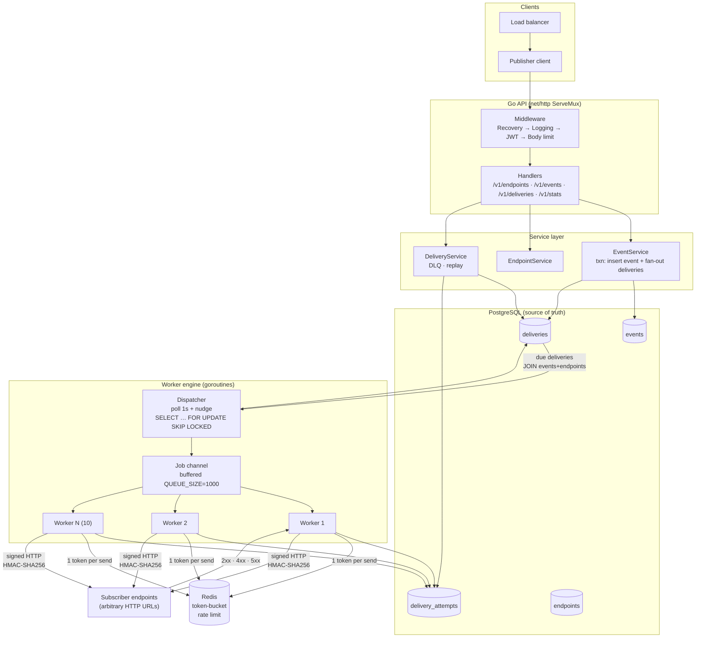
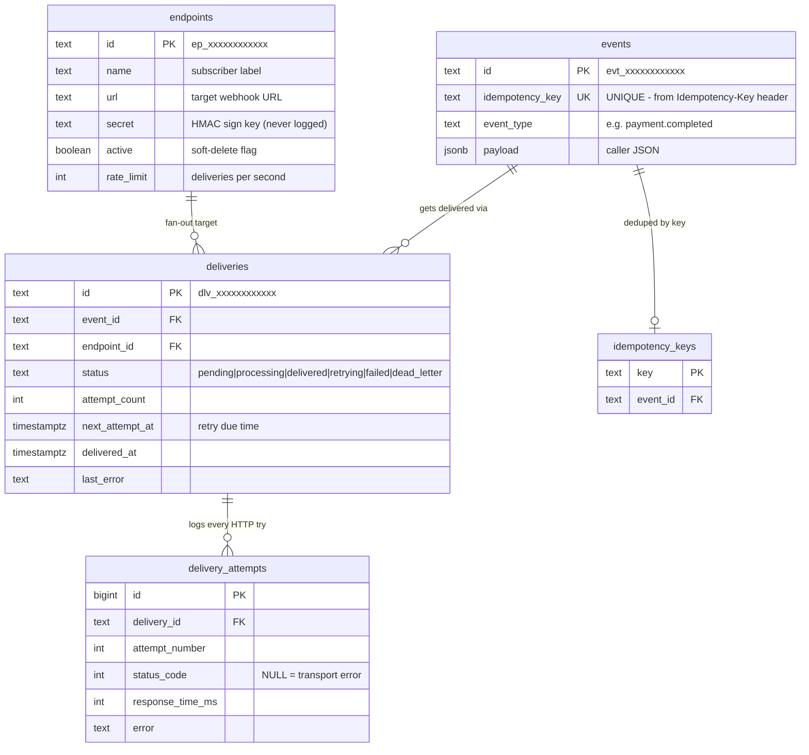
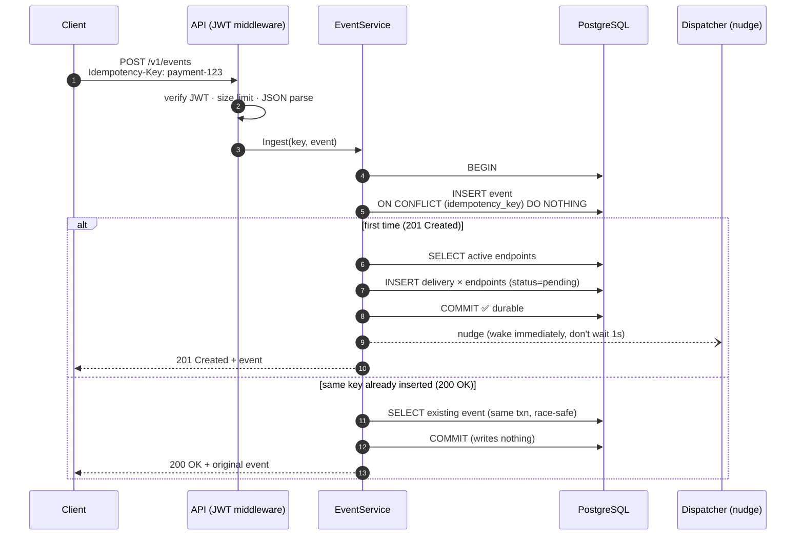
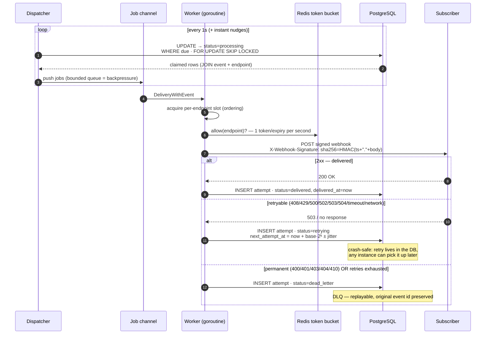
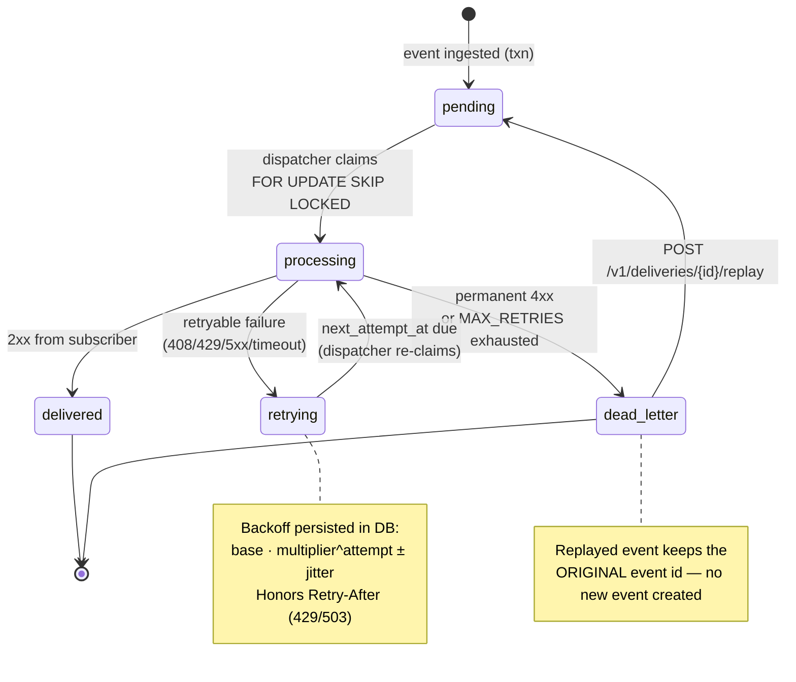
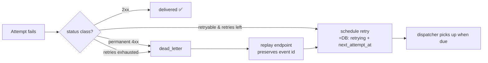
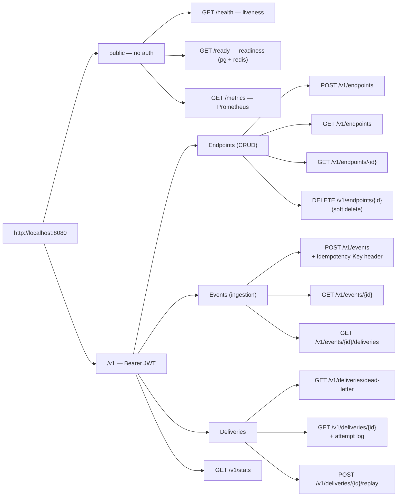
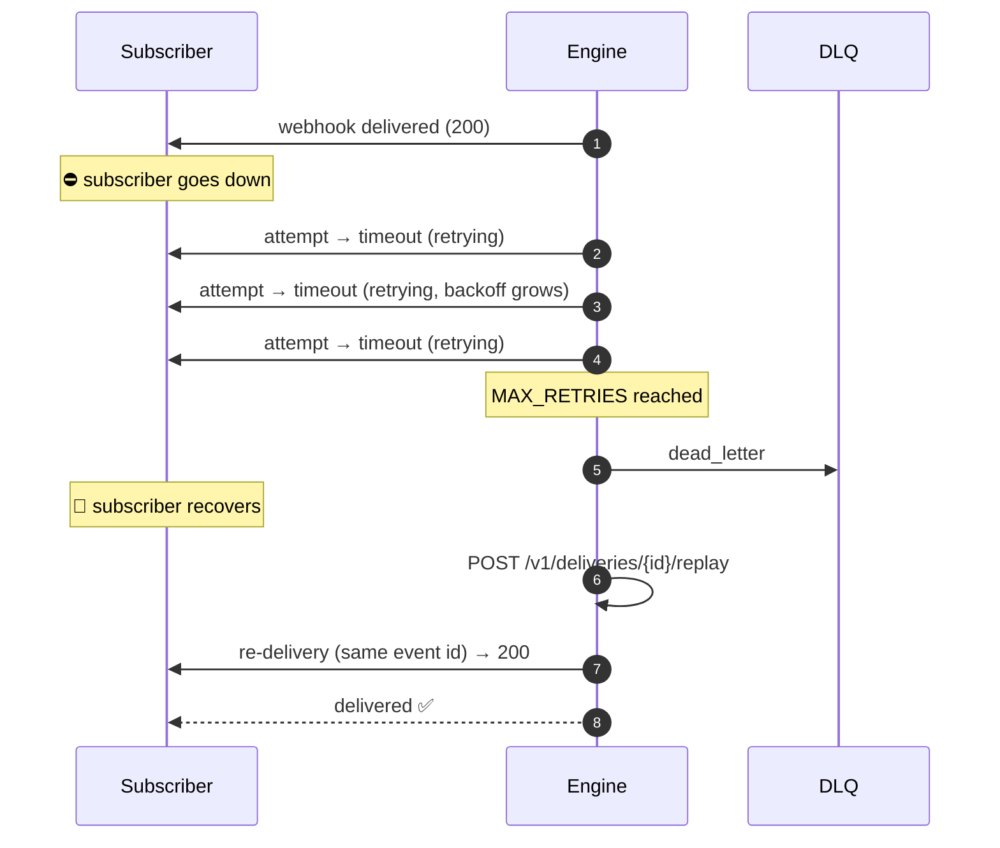

# Hookfire

[](https://github.com/Gauravmrjatt/hookfire/actions/workflows/ci.yml)
[](https://go.dev)
[](LICENSE)

A production-oriented, self-hosted **webhook delivery engine** in Go — in the
spirit of Svix/Hookdeck. Clients register endpoints, send events
idempotently, and the engine delivers them asynchronously to subscribers with
signing, retries, dead-lettering, replay, rate limiting, and metrics.

> **Guarantee: at-least-once delivery** — durable storage + retry-based
> recovery from transient failures. Exactly-once is impossible over HTTP and
> is deliberately not attempted.

> 📦 **Repo:** https://github.com/Gauravmrjatt/hookfire
> 🎓 **New to Go?** Read [docs/learning-guide-go-and-system-design.md](docs/learning-guide-go-and-system-design.md)
> first — it teaches every concept in this README through **Node.js
> comparisons**, with side-by-side code.

---

## Table of contents

1. [Architecture](#1-architecture)
2. [Data model](#2-data-model)
3. [Event ingestion flow](#3-event-ingestion-flow-idempotency)
4. [Delivery engine flow](#4-delivery-engine-flow)
5. [Delivery state machine](#5-delivery-state-machine)
6. [Retry policy](#6-retry-policy)
7. [REST API](#7-rest-api)
8. [Reliability map](#8-reliability-map)
9. [Scaling progression](#9-scaling-progression)
10. [Project layout](#10-project-layout)
11. [Quickstart](#11-quickstart)
12. [Full demo scenario](#12-full-demo-scenario)
13. [CI/CD](#13-cicd)
14. [Observability](#14-observability)
15. [Deployment](#15-deployment)
16. [Docs index](#16-docs-index)

---

## 1. Architecture



Key ideas:

- **PostgreSQL is the queue.** An accepted event already has its full
  fan-out plan (`deliveries` rows) committed in the same transaction.
- **Retries are durable.** Backoff is persisted (`status='retrying'`,
  `next_attempt_at`); the DB schedules retries, so crashes lose nothing.
- **`FOR UPDATE SKIP LOCKED`** lets N engine instances claim work without
  double-processing — a practical distributed work-queue without Kafka.

---

## 2. Data model



Why `delivery_attempts` exists: every HTTP attempt (even failed/timeout ones)
is recorded — it powers debugging, delivery history, and latency stats.

---

## 3. Event ingestion flow (idempotency)



The **DB unique constraint is the arbiter**, not an application
"if exists, return" — two concurrent requests (even on different engine
instances) cannot both create the event. Our integration test fires 100
concurrent requests with one key and asserts exactly **1 × 201 + 99 × 200
+ 1 distinct event id**.

---

## 4. Delivery engine flow



Crash safety: if a worker dies mid-attempt, the row is stuck in
`processing`; a janitor loop (`STALE_PROCESSING_TIMEOUT`) resets it to
`pending`, so **deliveries are never lost** — at worst re-attempted
(at-least-once, duplicates possible by design).

---

## 5. Delivery state machine



---

## 6. Retry policy

| Attempt | Delay (defaults) | Formula |
|---|---|---|
| 1 (initial) | immediate | — |
| 2 | 5s | `initial × m⁰` |
| 3 | 10s | `initial × m¹` |
| 4 | 20s | `initial × m²` |
| 5 | 40s | `initial × m³` |
| 6 | 80s | `initial × m⁴` |
| 7 | 160s | `initial × m⁵` |
| 8 (last) | capped 15m | `min(initial × m⁶, MAX_RETRY_DELAY)` |

- Every delay gets **±25% random jitter** → prevents synchronized retry
  storms when thousands of endpoints fail at once.
- `Retry-After` headers on 429/503 are honored (seconds or HTTP date),
  clamped to `MAX_RETRY_DELAY`.
- Classification is configurable:
  `RETRYABLE_STATUS_CODES=408,429,500,502,503,504` (+ all other 5xx + timeouts +
  network errors) · `PERMANENT_STATUS_CODES=400,401,403,404,410`.



---

## 7. REST API



Uniform error envelope (every non-2xx):

```json
{ "error": { "code": "INVALID_REQUEST", "message": "event_type is required" } }
```

Full reference with every request/response and curl examples:
[docs/api.md](docs/api.md).

### Try it

```bash
docker compose up -d                      # engine + postgres + redis
TOKEN=$(make token JWT_SECRET=change-me SUB=demo EXP=1h | tail -1)

# register a subscriber
curl -X POST http://localhost:8080/v1/endpoints \
  -H "Authorization: Bearer $TOKEN" -H "Content-Type: application/json" \
  -d '{"name":"my-sub","url":"http://host.docker.internal:9000/hook","rate_limit":50}'

# ingest an event (201 first time, 200 with the same Idempotency-Key)
curl -i -X POST http://localhost:8080/v1/events \
  -H "Authorization: Bearer $TOKEN" \
  -H "Idempotency-Key: payment-123-completed" \
  -H "Content-Type: application/json" \
  -d '{"event_type":"payment.completed","payload":{"payment_id":"pay_123"}}'
```

---

## 8. Reliability map

| Failure scenario | What the engine does |
|---|---|
| Postgres down at ingest | **503** — never a false 201 (no acceptance without durability) |
| Subscriber returns 5xx/timeout | retry with exponential backoff + jitter |
| Subscriber returns 4xx (400/401/404/410) | straight to DLQ (permanent) |
| `MAX_RETRIES` exhausted | DLQ + `webhook_dead_letter_total` metric |
| Worker crashes mid-attempt | `processing` row older than `STALE_PROCESSING_TIMEOUT` → reset to `pending` |
| Whole instance dies | other instances claim freely: `SKIP LOCKED`; stranded rows recovered on any survivor |
| Redis down while delivering | `RATE_LIMIT_FAIL_OPEN=true`: deliver anyway (default) · `false`: hold back until Redis returns |
| Process crash *after* HTTP sent, before DB update | duplicate delivery — inherent to at-least-once; subscribers dedupe via `X-Webhook-ID` |
| Duplicate ingest (same key, 100 races) | 1 event, 99 idempotent replays (DB constraint) |
| Client hits `/v1/events` without Idempotency-Key | 400 — header required |
| SSRF attempt (`http://169.254.169.254/...`) | rejected: scheme + resolved-IP denylist (loopback/private/link-local/metadata) |
| Subscriber slow (429 + Retry-After) | honored, clamped to max delay |

Full argument chain: [docs/reliability.md](docs/reliability.md).

---

## 9. Scaling progression

```mermaid
graph TB
    subgraph S1["Stage 1 — single instance"]
        A1[engine] --> P1[(Postgres)]
        A1 --> R1[(Redis)]
    end
    subgraph S2["Stage 2 — horizontal (ships: deployment replicas=2)"]
        LB["load balancer"] --> A2a & A2b
        A2a & A2b -- "SKIP LOCKED<br/>no double-processing" --> P2[(Postgres)]
        A2a & A2b --> R2[(Redis)]
    end
    subgraph S3["Stage 3 — partitioned workers"]
        P3[(Postgres)] --> "hash(endpoint_id) % N"
        PA[partition 0] --> C[consumer] & D[consumer]
        PB[partition 1] --> C
        PC[partition 2] --> D
    end
    subgraph S4["Stage 4 — Kafka (future, not implemented)"]
        K[events topic] --> G1[consumer group A] 
        K --> G2[consumer group B]
        LAG["monitor consumer lag,<br/>not CPU"]
    end
    subgraph S5["Stage 5 — K8s autoscaling (ships: HPA)"]
        HPS["HPA: CPU now<br/>→ queue depth / delivery lag next<br/>(Prometheus adapter)"]
    end
    S1 --> S2 --> S3 --> S4 --> S5
```

- **Stage 1→2**: API is stateless; workers coordinate purely via DB row
  locks. Bottleneck becomes Postgres commit rate.
- **Stage 3**: `hash(endpoint_id) % N` partitions give *structural* per-endpoint
  ordering; a hot subscriber pins its partition (documented tradeoff).
- **Stage 4**: Kafka replaces the claim loop; per-endpoint ordering comes from
  partition keys; lag = backlog, alert on lag not CPU.
- **Stage 5**: scale on delivery backlog (queue depth / oldest due age), not CPU —
  CPU is a lagging indicator for queue workers.

Details + measurement tooling: [docs/scaling.md](docs/scaling.md).

---

## 10. Project layout

```
cmd/
  server/       entrypoint (thin — wiring lives in internal/app)
  token/        JWT issuer CLI (demo tooling)
  loadtest/     load generator (PRD §35)
internal/
  app/          composition root: config → pg → redis → repos → services → workers → router
  config/       env-driven configuration (PORT, DATABASE_URL, JWT_SECRET, ...)
  model/        Endpoint · Event · Delivery · DeliveryAttempt + status constants
  repository/   pgx + raw SQL repos, migration runner (no ORM)
  service/      business logic: endpoints · events idempotency · deliveries/DLQ · stats
  handler/      HTTP handlers (decode/encode only — no business rules)
  middleware/   JWT auth · logging · recovery · body limits
  routes/       net/http ServeMux wiring
  worker/       dispatcher + pool · sender (HMAC/SSRF/timeout) · retry policy
  ratelimit/    Redis token bucket (Lua, atomic)
  metrics/      Prometheus instruments
pkg/
  logger/       slog JSON logger
  response/     uniform JSON error envelope
migrations/     versioned SQL, applied transactionally at boot
tests/integration/  end-to-end: ingest · concurrent idempotency · retry · DLQ · replay · rate limit
deployments/    docker assets · kubernetes manifests
docs/           architecture · api · scaling · reliability
```

*(This mirrors the classic Node.js express layout: `routes/` ≈ router,
`handler/` ≈ controllers, `service/` ≈ services, `repository/` ≈ DB layer,
`middleware/` ≈ express middleware.)*

---

## 11. Quickstart

```bash
cp .env.example .env          # JWT_SECRET is required
docker compose up -d          # or: make docker-up && make run

make test                     # unit tests (no deps needed)
make test-race                # go test -race ./...
make docker-up                # postgres + redis for integration tests
make test-integration         # full end-to-end suite

TOKEN=$(make token JWT_SECRET=change-me | tail -1)
```

All configuration is env-driven — see [.env.example](.env.example) for the
full annotated list (`WORKER_COUNT`, `QUEUE_SIZE`, `MAX_RETRIES`,
`INITIAL_RETRY_DELAY`, `MAX_RETRY_DELAY`, `BACKOFF_MULTIPLIER`,
`JITTER_FRACTION`, `REQUEST_TIMEOUT`, `DEFAULT_RATE_LIMIT`,
`RATE_LIMIT_FAIL_OPEN`, ...).

---

## 12. Full demo scenario

The story the whole system tells (PRD §48):



| Step | Command |
|---|---|
| start | `docker compose up -d` |
| health | `curl http://localhost:8080/health` |
| register subscriber | `POST /v1/endpoints` |
| send event | `POST /v1/events` (+`Idempotency-Key`) |
| watch it deliver | `GET /v1/events/{id}/deliveries` → `delivered` |
| stop subscriber, send event | retries start, delays grow |
| retries exhausted | `GET /v1/deliveries/dead-letter` shows it |
| restart subscriber, replay | `POST /v1/deliveries/{id}/replay` → delivered |
| metrics | `GET /v1/stats`, `GET /metrics` |

---

## 13. CI/CD

```mermaid
flowchart LR
    PUSH["push / PR"] --> LINT["gofmt check<br/>go vet"]
    LINT --> UNIT["go test ./...<br/>(unit)"]
    UNIT --> RACE["go test -race ./..."]
    RACE --> INT["integration tests<br/>real postgres + redis<br/>(services job)"]
    INT --> BUILD["go build")
    BUILD --> DOCKER["docker build"]
```

**Stack** (deliberate, PRD §4): Go 1.22 · `net/http` ServeMux patterns
(no Gin/Echo/Fiber) · pgx + raw SQL (no ORM) · Redis · JWT HS256 ·
HMAC-SHA256 · Prometheus · slog.

---

## 14. Observability

**Prometheus metrics** (low-cardinality labels only — never event ids/URLs/payloads):

```
webhook_events_total{outcome}          webhook_deliveries_total{status}
webhook_delivery_failures_total{endpoint_id}
webhook_delivery_retries_total{endpoint_id}
webhook_delivery_latency_seconds{endpoint_id}
webhook_queue_depth                    webhook_dead_letter_total
webhook_active_workers
```

**`/v1/stats`** — queue depth, active workers, deliveries total/succeeded/failed,
success rate, DLQ count, avg + p99 latency (sampled ring bucket, not full scans).

**Logs** — one structured JSON line per request + delivery events;
tokenized secrets/JWTs/payloads never logged.

---

## 15. Deployment

- **Dockerfile** — multi-stage, static binary, non-root user, baked-in health check.
- **docker-compose.yml** — engine + postgres + redis, health-gated startup order.
- **Kubernetes** (`deployments/kubernetes/`) — namespace, deployment
  (replicas=2 — safe by design via `SKIP LOCKED`; probes, resource limits),
  service, configmap, secret (fill in prod values), HPA (CPU-based first;
  the queue-depth strategy is documented in [docs/scaling.md](docs/scaling.md)).

---

## 16. Docs index

| Doc | What's inside |
|---|---|
| [docs/api.md](docs/api.md) | every endpoint: method, auth, headers, request/response, errors, curl |
| [docs/architecture.md](docs/architecture.md) | request flow, concurrency model, partitioning strategy (PRD §27) |
| [docs/reliability.md](docs/reliability.md) | at-least-once argument, crash recovery matrix, idempotency chain |
| [docs/performance.md](docs/performance.md) | micro-benchmarks, load-test method, honest TODOs |
| [docs/scaling.md](docs/scaling.md) | 5-stage progression, Kafka path, load-test methodology |
| [docs/learning-guide-go-and-system-design.md](docs/learning-guide-go-and-system-design.md) | 🎓 **Go + system design tutorial for Node.js developers** |
| [PRD.md](PRD.md) | the original product requirements |

## Known limitations

- **Best-effort ordering** per endpoint (not strict) — crash/rate-limit can reorder
- **Duplicates possible** in crash windows (inherent to at-least-once)
- Redis outage degrades rate limiting per `RATE_LIMIT_FAIL_OPEN`
- No multi-tenancy, Kafka, or dashboard (explicit PRD non-goals)
