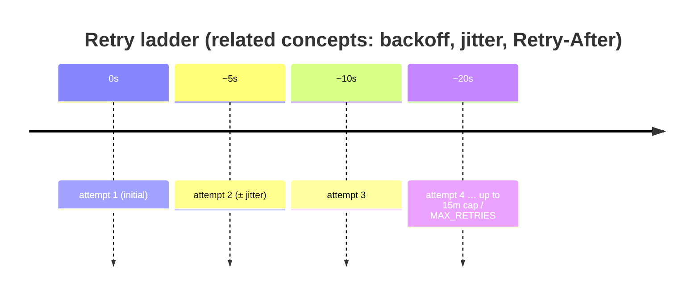
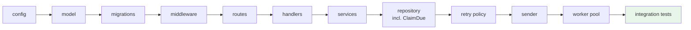

# 🎓 Learning guide: Go + System Design (for Node.js developers)

This document teaches you **everything the Hookfire project demonstrates**,
explained through Node.js comparisons. Read it top to bottom, then re-read
the source files it points to — it's a guided tour in dependency order.

> Prerequisite level assumed: you can write an Express app, use `pg`/mongo,
> know what a promise is. No Go knowledge assumed.

---

## Table of contents

1. [The big picture — what you're actually looking at](#1-the-big-picture)
2. [Runtime & concurrency: event loop vs goroutines](#2-runtime--concurrency)
3. [HTTP layer: Express vs net/http](#3-http-layer)
4. [Databases: pg vs pgx, and why no ORM](#4-databases)
5. [The system design concepts (the important part)](#5-the-system-design-concepts)
6. [Concept → file map](#6-concept--file-map)
7. [Guided reading order](#7-guided-reading-order)
8. [Go syntax survival guide](#8-go-syntax-survival-guide)
9. [Exercises](#9-exercises)

---

## 1. The big picture

You already use this design in Node.js. Hookfire is:

> **"An API that takes jobs, durably logs them, and hands them to background
> workers with retries."**

Node.js equivalent you may have built:

```js
// app.post('/events') → save to Redis/BullMQ → worker processes → retries → DLQ
```

The three pillars this project forces you to understand:

| Pillar | Node.js version you know | This project |
|---|---|---|
| **Queue** | BullMQ, SQS, RabbitMQ | PostgreSQL rows + `FOR UPDATE SKIP LOCKED` |
| **Workers** | BullMQ worker processes / `worker_threads` / cluster | goroutines + a channel |
| **Delivery guarantee** | at-least-once with job dedupe keys | at-least-once with `Idempotency-Key` |

The trick: **there is no separate queue product.** Postgres *is* the queue.
That is the system design lesson #1 — the "work queue" is a table with rows
in the state `pending`, atomically claimed with SQL row locks.

---

## 2. Runtime & concurrency

### The fundamental difference

**Node.js**: one thread, one event loop. Even "async" code runs serially —
that's why a heavy JSON parse or a crypto op blocks the API. You scale by
adding *processes* (cluster mode) or offloading to workers.

**Go**: 🚀 goroutines. Each goroutine is a cheap thread-like task (few KB).
You can spawn 10,000. The runtime multiplexes them onto OS threads. Blocking
one goroutine does **not** block the others.

```js
// Node.js: concurrent with async/await — but still ONE thread for CPU work
const results = await Promise.all(urls.map(fetch)) // I/O only
```

```go
// Go: truly parallel; each url runs on its own goroutine
var wg sync.WaitGroup
for _, u := range urls {
    wg.Add(1)
    go func(u string) {          // spawn
        defer wg.Done()          // like .finally() counting dec
        deliver(u)
    }(u)
}
wg.Wait()                        // like awaiting Promise.all
```

| Node.js concept | Go equivalent | File to see it |
|---|---|---|
| `async`/`await` | goroutine + blocking call (the runtime resumes you) | `internal/worker/worker.go` |
| `Promise.all` | `sync.WaitGroup` | `internal/worker/worker.go` |
| Event queue / task queue | **channel** (`chan model.DeliveryWithEvent`) | worker pool |
| `EventEmitter` | channel (typed send/receive) | dispatcher→workers |
| `Promise.race([p, timeout])` | `select { case <-ctx.Done(): ... case <-ch: ... }` | everywhere (`context.Context`) |
| AbortController / AbortSignal | `context.Context` cancellation | request + worker paths |
| `cluster.fork()` × N | spawn N goroutines of a loop | worker pool startup |
| `worker_threads` | goroutine | — |
| global singleton | package-level state or dependency-injected struct | `internal/app/app.go` |

### The worker pool — side by side

These two do the **same thing**:

```js
// Node.js (BullMQ-style pseudo)
const worker = new Worker('deliveries', async (job) => {
  await deliver(job.data);
}, { concurrency: 10 });
await queue.add('deliveries', job);        // Redis-backed queue
```

```go
// Go (this is internal/worker/worker.go, simplified)
func (p *Pool) workerLoop(ctx context.Context) {
    for {
        select {
        case job := <-p.jobs:              // receive from channel — blocks if empty
            p.process(ctx, job)
        case <-ctx.Done():                 // graceful shutdown signal
            return
        }
    }
}
```

The Node version stores the queue in **Redis**; the Go version stores it in
**Postgres** (the channel is just an in-memory hand-off buffer). Two facts
make the Go one special:

1. **Backpressure is explicit**: `jobs` is created as
   `make(chan Job, QUEUE_SIZE)`. When full, the dispatcher stops claiming —
   the system cannot read unbounded work into memory.
2. **The queue is durable**: if the process crashes, jobs are still rows in
   `deliveries` with `status='pending'`. In the BullMQ case *queued-in-memory*
   work dies with the process; here it cannot.

### `context.Context` — AbortSignal for everything

```js
const res = await fetch(url, { signal: AbortSignal.timeout(10_000) });
```

```go
ctx, cancel := context.WithTimeout(ctx, 10*time.Second)
defer cancel()
req, _ := http.NewRequestWithContext(ctx, "POST", url, body)
res, err := client.Do(req)   // aborted when ctx times out/cancels
```

Every handler and every worker function takes `ctx` as the first argument.
It carries: deadlines, cancellation ("shutdown! stop what you're doing"),
and traced request values. Always pass it down; never store it in structs.

### Data race — why `go test -race` exists

Node.js is single-threaded so shared state is "safe by default". In Go
two goroutines writing `counter++` simultaneously = silent data corruption.
The race detector (`go test -race ./...`) catches it. In this repo you'll see
`sync.Mutex` around shared maps (`Pool.slots`) and `atomic.Int64` for counters
(`p.inFlight`) — the Go way of saying "this value crosses goroutine
boundaries".

---

## 3. HTTP layer

### Express vs `net/http`

```js
// Express
app.use(helmet())                                   // middleware
app.use(auth)
router.post('/v1/events', createEvent)              // handler
app.get('/events/:id', getEvent)                    // params
```

```go
// net/http — same shape, standard library only
mux := http.NewServeMux()
mux.HandleFunc("POST /events", events.Create)       // method + path pattern!
mux.HandleFunc("GET /events/{id}", events.Get)      // go 1.22+ wildcard params
```

Note the **method prefix** (`"POST /events"`) — a router feature you'd
otherwise import Express for. `r.PathValue("id")` = `req.params.id`.

### Middleware

```js
// Express: (req, res, next) => {}
function auth(req, res, next) { /* verify jwt */ next(); }
```

```go
// Go: a function that RETURNS a handler — wrapping is the composition
func JWTAuth(secret string) func(http.Handler) http.Handler {
    return func(next http.Handler) http.Handler {
        return http.HandlerFunc(func(w http.ResponseWriter, r *http.Request) {
            // ... verify token or write 401 and return (like ending the response
            // without calling next())
            next.ServeHTTP(w, r)            // ← this IS next()
        })
    }
}
```

You wrap instead of registering: `Logging(log)(Recovery(log)(router))`.
Same mental model, inverted composition. See
`internal/middleware/common.go` → `Logging`, `Recovery`, and
`auth.go` → `JWTAuth`.

### Layers — it's exactly your node folder structure

| Node convention | This repo | Role |
|---|---|---|
| `routes/` | `internal/routes/` | URL wiring only |
| `controllers/` | `internal/handler/` | parse HTTP, call service, write response |
| `services/` | `internal/service/` | business logic, validation, transactions |
| `repositories/`/`db/` | `internal/repository/` | SQL only |
| `prisma/schema.prisma` | `migrations/*.sql` | schema |
| `models/` | `internal/model/` | plain data types |
| `config/` | `internal/config/` | env parsing |
| DI container/index.js | `internal/app/app.go` | wire everything, graced shutdown |

Handlers are kept dumb on purpose. `POST /v1/events` logic lives in
`EventService.Ingest` — which is why integration tests can drive it through
the full HTTP stack *without* network setup weirdness.

### Request body + JSON

```js
app.post('/events', express.json({ limit: '1mb' }), (req, res) => res.status(201).json(ev))
```

```go
var req model.CreateEventRequest
// body size capped BEFORE parse: http.MaxBytesReader — internal/middleware/common.go
if err := json.NewDecoder(r.Body).Decode(&req); err != nil {
    response.BadRequest(w, "invalid JSON body: "+err.Error())
    return
}
response.JSON(w, http.StatusCreated, ev)   // struct tags: `json:"event_type"`
```

Struct tags are the Go `class-transformer`/zod coercion. The response helper
(`pkg/response/response.go`) enforces the one error envelope for the whole
API — like a shared `errorHandler` middleware.

### Errors: values, not throws

Go has no exceptions in the normal path — functions return `(value, error)`
and you check:

```go
ep, err := h.svc.Get(ctx, id)
if errors.Is(err, service.ErrNotFound) {    // errors.Is ≈ instanceof for sentinel errors
    response.Error(w, 404, "NOT_FOUND", err.Error())
    return
}
```

Sentinel errors (`ErrNotFound`, `ErrValidation`) are sentinels like
`Error("NOT_FOUND")` objects in Node. Panics exist but are reserved for
programmer bugs — the `Recovery` middleware is like Express's default
error-handling middleware catching them.

---

## 4. Databases

### pg vs pgx

The API is nearly identical to `node-postgres`:

```js
const pool = new pg.Pool({ connectionString: process.env.DATABASE_URL })
await pool.query('SELECT * FROM endpoints WHERE id = $1', [id])   // always parameterize!
await pool.query('BEGIN'); ...await pool.query('COMMIT')          // manual txn
```

```go
pool, _ := pgxpool.New(ctx, cfg.DatabaseURL)                        // internal/repository/db.go
pool.QueryRow(ctx, "SELECT ... WHERE id = $1", id).Scan(&a, &b)    // Scan ≈ row destructuring
tx, _ := pool.Begin(ctx); defer tx.Rollback(ctx)                   // rollback-if-not-committed
_, err = tx.Exec(ctx, "INSERT ...", args)
tx.Commit(ctx)
```

Key habits you must internalize:

1. **Never interpolate values into SQL strings** — placeholders `$1, $2` are
   the parameterization (`pg` question marks / `$n` same thing). PRD §31 rule.
2. **`defer tx.Rollback(ctx)`** right after `Begin` is the standard Go
   transaction pattern: rollback is a no-op after commit. It means "if *any*
   error path forgot to commit → undo". This pattern alone prevents the
   half-written-event class of bugs.
3. **One semantic = one transaction.** Event + fan-out deliveries are written
   together (`EventService.Ingest`) so accepted events can never lose their
   delivery plan.

### Migrations without an ORM

Node: `prisma migrate` / `knex migrate`. Here: plain `.sql` files applied in
name order; the runner (`internal/repository/db.go` → `Migrate`) records
success in `schema_migrations` so re-runs are no-ops, and each file runs in
its own transaction. Reading raw SQL migrations is a *feature* — you see
exactly what the indexes are: `deliveries(status)`, `deliveries(next_attempt_at)` —
the queries for "what work is due" are indexed; that's what keeps
`/v1/stats` cheap.

### Postgres as a queue — the money query

```sql
WITH claimed AS (
    UPDATE deliveries SET status = 'processing', updated_at = now()
    WHERE id IN (
        SELECT id FROM deliveries
        WHERE status IN ('pending','retrying') AND next_attempt_at <= now()
        ORDER BY next_attempt_at, created_at
        LIMIT $1
        FOR UPDATE SKIP LOCKED        -- ← the magic
    )
    RETURNING id
)
SELECT ... FROM claimed JOIN deliveries/events/endpoints ...
```

What `FOR UPDATE SKIP LOCKED` does (this is the interview answer):

- Two engine instances run this at the same moment.
- Both scan the same due rows. Postgres gives the locked rows to whoever
  gets there first; the **other instance's query skips them** instead of
  waiting — and processes the *next* ones.
- Result: N instances share one queue with zero coordination, exactly one
  claimer per delivery. It's how you replace Redis/RabbitMQ with SQL.

Node equivalent: BullMQ does this with its own atomic `RPOPLPUSH`/scripts.
Same distributed concept, different tool — and Postgres additionally gives
you transactions and history for free.

---

## 5. The system design concepts

These are the concepts this project is a vehicle for. Each has a one-line
Node.js anchor to attach it to.

### 5.1 Delivery semantics — at-least-once

Question every async system must answer: *what do we promise when everything
fails?* Options:

| Semantics | Meaning | Cost |
|---|---|---|
| at-least-once | may deliver more than once, never loses | duplicates possible |
| at-most-once | may lose, never duplicates | early abandon |
| exactly-once | once, no dupes, no loss | impossible over arbitrary HTTP |

HTTP can't give exactly-once: subscriber processed your webhook, died before
responding, you retry → duplicate. Fundamental. So the design says
**at-least-once** and compensates with (5.2). The crash window is documented
in `docs/reliability.md` §2 — "we know exactly where duplicates can occur"
is the engineering statement you want to be able to make.

### 5.2 Idempotency

If retries exist, the *consumer* must tolerate repeats. Two sides:

- **Inbound** (publisher → this API): `Idempotency-Key` header + unique
  index. Retried publishes don't duplicate events. Implemented with
  `INSERT ... ON CONFLICT DO NOTHING` + same-txn readback — the DB arbitrates
  concurrence, not app-level checks (app checks are racy; the DB constraint
  is atomic). The integration test `TestIdempotencyUniqueConstraint` fires
  100 concurrent requests → asserts 1×201 + 99×200.
- **Outbound** (this API → subscribers): every webhook carries
  `X-Webhook-ID` + `X-Webhook-Delivery` + signed timestamp; subscribers
  dedupe on it.

Node anchor: Stripe's `Idempotency-Key` header — same mechanism, and Stripe
also uses indexes, not app-level maps.

### 5.3 Backpressure

If producers outpace consumers you must *resist* taking more work, or
memory dies. Here: the job channel is bounded (`QUEUE_SIZE=1000`); the
dispatcher claims at most
`min(QUEUE_SIZE - len(jobs), CLAIM_BATCH_SIZE)` rows per tick. Claiming is
debt you can't pay — so you cap it. Node anchor: BullMQ queue limiter,
`stream` `highWaterMark`, express `server.maxRequests`.

### 5.4 Retries: exponential backoff + jitter

`delay = min(initial × multiplier^attempt, max) ± jitter`

- Exponential: give a dying dependency time to heal (5s→10s→20s→…→15m cap).
- **Jitter**: without it, 10,000 deliveries failing at the same instant all
  retry at exactly the same tick → thundering herd kills the subscriber for
  good. Randomizing ±25% smears retry bursts into a smooth curve.
- Status classification is data, not code: retryable
  (408/429/5xx/timeouts) vs permanent (400/401/403/404/410) → configurable
  lists (`RETRYABLE_STATUS_CODES`). 429 + `Retry-After` honored.
- **The retry schedule lives in the DB** (`status='retrying'`,
  `next_attempt_at`), not in memory (`setTimeout`). Crash-safe. This is the
  single most important implementation decision in the project.



### 5.5 Dead-letter queue (DLQ) + replay

After `MAX_RETRIES` (or permanent 4xx): stop burning CPU on a hopeless retry,
park it (`status='dead_letter'`), expose it (`GET /v1/deliveries/dead-letter`),
and let an operator or cron **replay** it (reset → pending → delivered).
Replay is the hero feature: same event id, no new event created. Node anchor:
BullMQ failed-jobs list + `job.retry()` from the dashboard.

### 5.6 Rate limiting — token bucket

Per-endpoint, shared across instances → must live in Redis. Token bucket:
capacity `C`, refill rate `R`; each send consumes 1 token; empty = wait.
Atomic via a Lua script (Redis executes scripts single-threaded → no races).
Also defines failure behavior: `RATE_LIMIT_FAIL_OPEN` (availability over
protection, default) vs fail closed (protect subscribers at the cost of
stalled deliveries). Recording *that decision* is the design maturity signal.
Node anchor: `bottleneck`, `rate-limiter-flexible`, gateway middleware.

### 5.7 Observability

You can't operate an async engine on logs alone.

- **Metrics** (Prometheus): counters (`webhook_deliveries_total`), histograms
  (`webhook_delivery_latency_seconds` → p99), gauges (`webhook_queue_depth`).
- **Cardinality discipline**: labels like `endpoint_id` (bounded), never
  `event_id`/URL (unbounded → metric explosion). Real-world lesson.
- **Stats from instrumentation, not `SELECT count(*)`** — except the DLQ
  count (indexed column, cheap).
- **Structured logging** (`log/slog` JSON) → grep/gauge/filter; and never log
  secrets/JWT (see what's *absent* from the log lines).

### 5.8 Security model

- SSRF: users send you URLs → you will make *your server* call them → they
  point at `169.254.169.254` (AWS metadata) or internal services.
  Mitigation: scheme allowlist + resolve host + denylist loopback/private/
  link-local IPs before every call (`internal/worker/sender.go`).
- HMAC-SHA256 signatures on outbound webhooks so subscribers know it's us:
  `sign = HMAC(secret, timestamp + "." + raw_body)`; timestamp prevents
  replay attacks (subscriber rejects >5min-old webhooks).
- JWT (HS256, exp enforced) for the API — same as your `jsonwebtoken` usage.
- Body limits both directions; parameterized SQL; secrets only from env.

### 5.9 Horizontal scaling & ordering

Stateless API → replicas behind LB. Workers coordinate through DB locks only
→ replicas are *worker-safe by construction* (SKIP LOCKED). Ordering:
best-effort per-endpoint via a per-endpoint in-process slot — never claim
strict ordering in a distributed system without partitioning (that's why
the partitioning-by-`hash(endpoint_id)` future is documented, and why Kafka's
partition keys would give it structurally).

### 5.10 Graceful shutdown

SIGTERM → stop accepting HTTP → drain in-flight HTTP → cancel worker ctx →
wait for in-flight deliveries → exit. Anything mid-flight is recovered
later by the stale-processing janitor. Node anchor: `server.close()` +
SIGTERM handler on Kubernetes pods — here it's `internal/app/app.go` `Run()`.

---

## 6. Concept → file map

| Concept | File | What to read for |
|---|---|---|
| dependency wiring | `internal/app/app.go` | composition root, graceful shutdown |
| env config | `internal/config/config.go` | parsing, validation, defaults |
| router | `internal/routes/routes.go` | method patterns, grouping, middleware split |
| middleware | `internal/middleware/*.go` | JWT, logging, panic recovery, body limits |
| error envelope | `pkg/response/response.go` | uniform API errors |
| idempotent ingest | `internal/service/event_service.go` | the transaction, ON CONFLICT |
| SQL repos | `internal/repository/*.go` | parameterization, Scan, joins |
| **the queue** | `internal/repository/deliveries.go` → `ClaimDue` | FOR UPDATE SKIP LOCKED |
| worker pool | `internal/worker/worker.go` | channels, select, mutex/atomic |
| signing/SSRF | `internal/worker/sender.go` | HMAC, http.Client discipline |
| retry policy | `internal/worker/retry.go` | backoff math, classification |
| rate limit | `internal/ratelimit/redis.go` | Lua token bucket |
| metrics | `internal/metrics/metrics.go` | instrument choices |
| migrations | `migrations/001_initial.sql` | schema + indexes |
| tests | `tests/integration/engine_test.go` | how you *prove* the guarantees |
| k8s | `deployments/kubernetes/deployment.yaml` | probes, replicas, env |

---

## 7. Guided reading order

Suggested path — each step builds on the previous:

1. `internal/config/config.go` — plain struct + env parsing. Warm-up.
2. `internal/model/event.go`, `endpoint.go`, `delivery.go` — the nouns.
3. `migrations/001_initial.sql` — the nouns become tables. Read the indexes.
4. `internal/middleware/common.go` + `auth.go` — the Express analogies click here.
5. `internal/routes/routes.go` + `internal/handler/endpoint_handler.go` — route to
   handler flow.
6. `internal/service/endpoint_service.go` — first service; validation + repo call.
7. `internal/service/event_service.go` — ⭐ the transaction and idempotency. Read slowly.
8. `internal/repository/deliveries.go` → `ClaimDue` — ⭐ the queue.
9. `internal/worker/retry.go` — backoff math (small file, pure logic).
10. `internal/worker/sender.go` — HTTP client + HMAC + SSRF.
11. `internal/worker/worker.go` — ⭐⭐ the payoff: dispatcher, pool, state machine
    transitions in `process()`.
12. `tests/integration/engine_test.go` — see the guarantees tested as behavior,
    strong review of everything above.



---

## 8. Go syntax survival guide

The 15% of the language you need for this codebase:

```go
// types + structs with tags (≈ TS interfaces + serde)
type Event struct {
    ID        string    `json:"id"`
    EventType string    `json:"event_type"`
    Payload   json.RawMessage `json:"payload"`  // raw JSON bytes ≈ unknown
}

// functions can return two values (no exceptions)
func Get(id string) (Event, error)

// zero values: no undefined/null panics — "" , 0, false, nil slices
var names []string        // nil slice is usable: len(names)==0, append works

// slices & maps (≈ arrays & objects, but reference types)
endpoints := map[string]Endpoint{}
ep, ok := endpoints[id]   // "comma ok" — ≈ id in obj

// methods = functions with a receiver
func (s *EventService) Ingest(ctx context.Context, ...) (AcceptedEvent, error)

// pointers EXPLICIT (JS references are implicit; Go copies values unless &)
func mutate(ep *Endpoint) // *Endpoint = pass by reference

// interfaces: structural — implemented implicitly (no `implements`)
type DeliveryStore interface {
    ClaimDue(ctx context.Context, limit int) ([]model.DeliveryWithEvent, error)
    ...
}

// error checks everywhere — verbosity on purpose: errors are part of control flow
if err != nil { return fmt.Errorf("claim due deliveries: %w", err) }  // %w wraps (like cause)

// defer — runs at function exit (≈ try/finally)
defer tx.Rollback(ctx)
defer mu.Unlock()

// select — wait on multiple channels (≈ Promise.race)
select {
case job := <-jobs:
case <-ctx.Done(): return
}

// goroutines + sync
go worker(ctx)
var wg sync.WaitGroup
```

Also: `5*time.Second`, `time.Duration` are typed ints; strings are immutable;
`%s/%d/%v` verbs in `fmt.Sprintf`; exported names start **uppercase**, that
is *the* visibility rule (no `export` keyword).

---

## 9. Exercises

Learn by doing — each maps 1:1 to running code:

1. **Beginner**: add a `PATCH /v1/endpoints/{id}` that updates `rate_limit`
   (model tag → repo SQL → service validation → handler → routes). Follow
   the layer-by-layer path handlers take.
2. **Beginner+**: hit `/v1/events` twice with the same Idempotency-Key and
   watch both paths in `EventService.Ingest` fire (201/200).
3. **Intermediate**: simulate a dead subscriber with `nc -l` (accept, never
   respond), watch the retry ladder in `deliveries.next_attempt_at` column.
4. **Intermediate**: break the Lua token bucket on purpose (drop a token
   without refill) and observe rate-limit retries in logs — then write the
   test that would have caught it.
5. **Advanced**: implement a second instance (`PORT=8081 docker compose
   scale`-style), ingest concurrently, and verify with SQL that no delivery
   is claimed twice:
   `SELECT id FROM deliveries WHERE status='processing' HAVING count(*)>1` —
   it returns nothing; explain why (SKIP LOCKED).
6. **Interview prep**: answer in one breath — "Why is Postgres enough here
   instead of Kafka?" (claim batch = 1 UPDATE, retries durable, history
   free; Kafka earns its ops cost only at Stage-4 partition-scale loads).

---

*End of guide. Next: run `make test`, then start at the top of the guided
reading order with the code open.*
